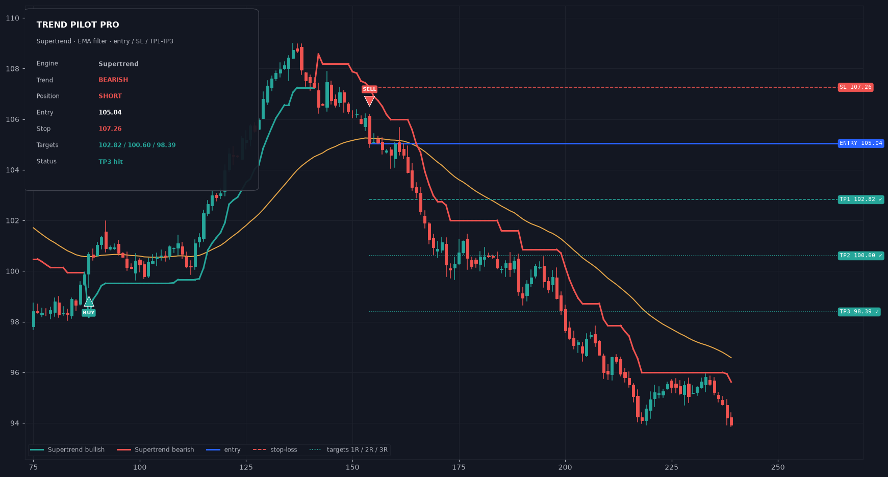
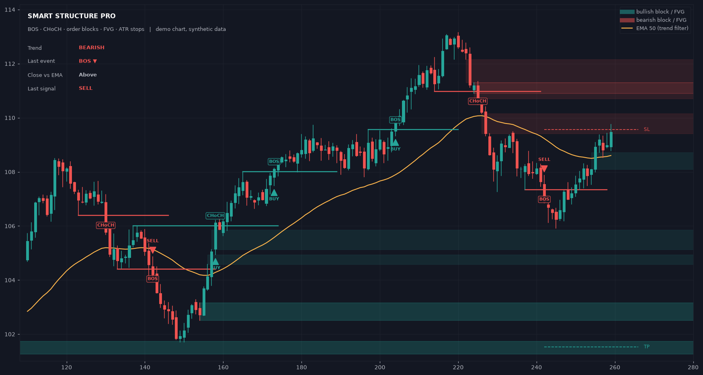

# TradingView indicators

Two self-contained Pine Script v6 indicators, ready to paste into TradingView.
Both are **one file, no dependencies**, work on any symbol/timeframe, and ship with
alerts.

| File | What it is | Best for |
|---|---|---|
| [`indicators/TrendPilotPro.pine`](indicators/TrendPilotPro.pine) | **Trend Pilot Pro** — buy/sell arrows + entry / stop-loss / TP1-TP2-TP3 lines on the chart | trend following, scalping, swing entries |
| [`indicators/SmartStructurePro.pine`](indicators/SmartStructurePro.pine) | **Smart Structure Pro** — BOS/CHoCH structure, order blocks, fair value gaps, signals | smart-money / price-action trading |

---

# 1 · Trend Pilot Pro  ⭐ (the "arrows + target lines" style)

*Preview rendered from the indicator's own logic on synthetic data
(`preview/render_trend_preview.py`).*

### What you get on the chart

- **BUY / SELL arrows** when the trend engine and filters agree.
- **Blue entry line** at the signal close.
- **Red dashed stop-loss line** (ATR, engine stop or swing stop — your choice).
- **TP1 / TP2 / TP3 lines** at 1R / 2R / 3R (any multiple you want), with
  price labels at the right edge; each target shows a `✓` once price reaches it,
  and the stop label shows `✗` if the trade is stopped out.
- **Trailing trend line** (Supertrend / UT Bot trail / EMA pair) plotted behind price.
- **Dashboard**: engine, trend, position, entry, stop, targets, status, R:R.
- **6 alerts**: BUY, SELL, TP1, TP2, TP3, stop hit.

### Signal engines (Settings → 1 · Signal engine)

| Engine | Character |
|---|---|
| **Supertrend** (default, ATR 10 × 3.0) | Classic workhorse. Clean trends, some whipsaw in ranges. |
| **UT Bot (ATR trail)** | Tighter trailing stop, good for intraday scalps. |
| **EMA crossover** (21 / 55) | Slowest and smoothest. Good on higher timeframes. |

A signal fires on the **first bar where the engine direction and the filters agree**
— so it catches both fresh flips and clean re-entries after a pullback, not only the
exact flip candle.

### Filters (Settings → 2 · Filters)

- **EMA direction filter** (default ON, 200 EMA) — longs only above, shorts only below.
- **ADX filter** (default OFF, minimum 20) — skips dead, choppy markets.
- **Cooldown** (default 3 bars) — stops one signal turning into five.
- **Signals on bar close only** (default ON) — arrows never appear/reappear mid-candle,
  i.e. **no repainting**.

### Stop & targets (Settings → 3)

- `ATR stop` (default): stop = worst of signal bar / previous bar ± 1.5 × ATR.
- `Engine stop`: uses the Supertrend or UT Bot line itself.
- `Swing stop`: highest high / lowest low of the last *n* bars.
- Targets are **R multiples** of that stop, so risk is always defined before entry.

Recommended starting points: 1m-5m → Supertrend ATR 10 × 2.0, targets 1/1.5/2R;
15m-1h → defaults; 4h-1D → EMA cross, targets 2/3/5R.

### Alerts

Right-click chart → **Add alert** → Condition = *Trend Pilot Pro* → pick the event.
Use **Once per bar close** for the BUY/SELL alerts.

---

# 2 · Smart Structure Pro

| Feature | What it does |
|---|---|
| **BOS / CHoCH** | Structure breaks. `BOS` = continuation, `CHoCH` = change of character. |
| **Order blocks** | Last opposite-colour candle before a break; deleted when price closes through. |
| **Fair value gaps** | 3-candle imbalance boxes with a minimum-size filter (× ATR). |
| **BUY / SELL arrows** | Structure break + EMA filter + optional fresh FVG. |
| **ATR stop / target** | Dashed lines from the last signal. |
| **Dashboard + 4 alerts** | Trend, last event, price vs EMA, last signal. |

Same install steps, same non-repainting behaviour (bar-close evaluation, pivots
confirmed after `swing length` bars).

---

## Install (2 minutes, either indicator)

1. TradingView → **Pine Editor** (bottom panel) → **Open → New blank indicator**.
2. Delete the template, paste the whole file.
3. **Save** → **Add to chart**.
4. Tune it with the gear icon (every input has a tooltip).

## Notes & honesty

- These are **indicators**, not strategies: they don't backtest in the Strategy
  Tester and they don't place trades. Alerts are how you automate them.
- No indicator predicts the future. Both use closed-bar data, so arrows are stable,
  but that also means they appear at bar close, not before.
- Nothing here is financial advice. Test on a demo account, and size positions from
  your own risk rules — the ATR stop is a starting point, not a promise.

---

### About the Instagram reel

The reel link (`instagram.com/reel/DfUi0luT9Qz`) can't be opened from the build
environment — Instagram returns HTTP 403 to anything that isn't a logged-in browser,
so the exact indicator in the video couldn't be watched. Based on the follow-up
answers (*trend / buy-sell arrows* + *lines with target levels*), **Trend Pilot Pro**
was built to match that style. If the reel used a specific engine (HalfTrend, a
particular Supertrend setting, an EMA ribbon, RSI-based arrows…), or you can share
a screenshot of the chart, the script can be matched exactly.
